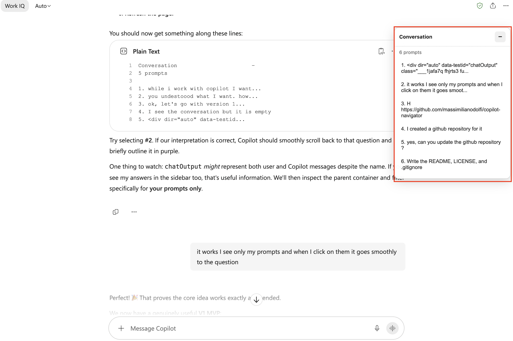

# Copilot Navigator

Copilot Navigator is a lightweight browser extension that adds a lateral conversation index to Microsoft Copilot. It lists your prompts and lets you jump smoothly back to any question in a long conversation.

## Demo


## Features

- Automatically detects and lists your prompts
- Selects a prompt and scrolls smoothly to the original question
- Briefly highlights the selected prompt
- Updates automatically as the conversation grows
- Collapsible navigation panel
- Supports light and dark browser themes
- Runs locally in the browser
- Requires no backend, database, or external service

## Supported browsers

Copilot Navigator uses the Manifest V3 extension format and is intended for:

- Microsoft Edge
- Google Chrome and other Chromium-based browsers

The current manifest supports these Copilot URLs:

- `https://m365.cloud.microsoft/*`
- `https://copilot.microsoft.com/*`

## Installation

### Microsoft Edge

1. Clone or download this repository.
2. Open `edge://extensions` in Microsoft Edge.
3. Enable **Developer mode**.
4. Select **Load unpacked**.
5. Select the repository directory containing `manifest.json`.
6. Open or refresh Microsoft Copilot.

### Google Chrome

1. Clone or download this repository.
2. Open `chrome://extensions` in Google Chrome.
3. Enable **Developer mode**.
4. Select **Load unpacked**.
5. Select the repository directory containing `manifest.json`.
6. Open or refresh Microsoft Copilot.

## Usage

After installation, open a Copilot conversation. A **Conversation** panel appears on the right side of the page.

- Select a numbered prompt to return to that question.
- Select the minus button to collapse the panel.
- Select the plus button to expand it again.
- New prompts are added automatically while the conversation is open.

## Project structure

```text
copilot-navigator/
├── manifest.json
├── content.js
├── styles.css
├── README.md
├── LICENSE
└── .gitignore
```

## How it works

The extension injects `content.js` and `styles.css` into supported Copilot pages. It detects user prompts using the following element:

```css
[data-testid="chatOutput"]
```

A `MutationObserver` watches the page for conversation updates. When a navigation item is selected, the corresponding prompt is brought into view with `scrollIntoView()` and temporarily highlighted.

## Privacy

Copilot Navigator runs entirely in the browser. It does not send conversation content to a backend, external API, analytics service, or AI service.

The extension requests no additional browser permissions. It only runs on the Copilot URLs declared in `manifest.json`.

## Current limitations

- Microsoft may change the Copilot page structure or `data-testid` attributes, which could require updating the prompt selector.
- The extension is loaded manually in developer mode and is not currently distributed through a browser extension store.
- Version 0.1 provides prompt navigation only. It does not yet include search, bookmarks, custom titles, or saved panel state.

## Development

After changing the source files:

1. Open the browser's extensions page.
2. Select **Reload** for Copilot Navigator.
3. Refresh the Copilot page.
4. Test prompt detection, automatic updates, collapsing, smooth scrolling, and highlighting.

No build step or package installation is required.

## Roadmap

Potential future improvements include:

- Search and filtering
- Bookmarked prompts
- Remembered expanded or collapsed state
- Current-prompt highlighting while scrolling
- Editable or automatically shortened prompt titles
- Additional layout and accessibility improvements

## Contributing

Issues and pull requests are welcome. Keep changes focused, dependency-free where practical, and compatible with Manifest V3.

## License

This project is licensed under the MIT License. See [LICENSE](LICENSE) for details.
